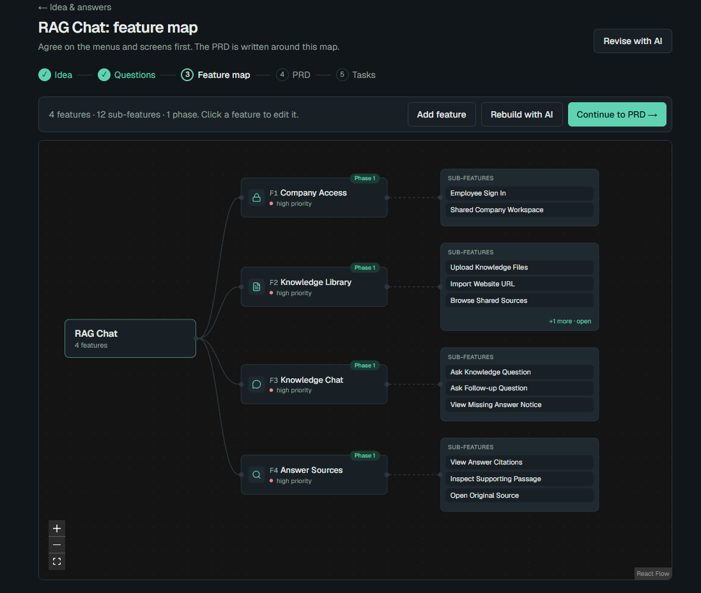
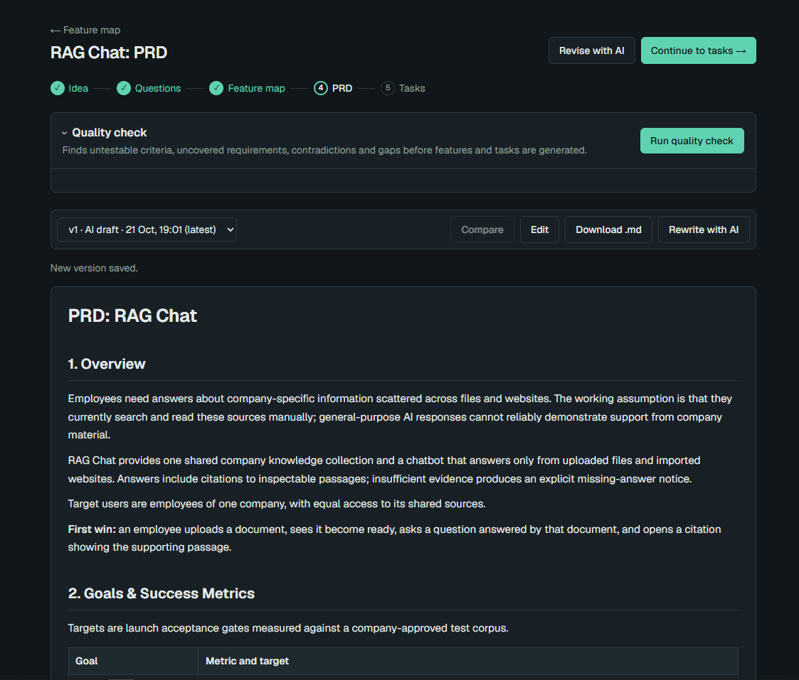
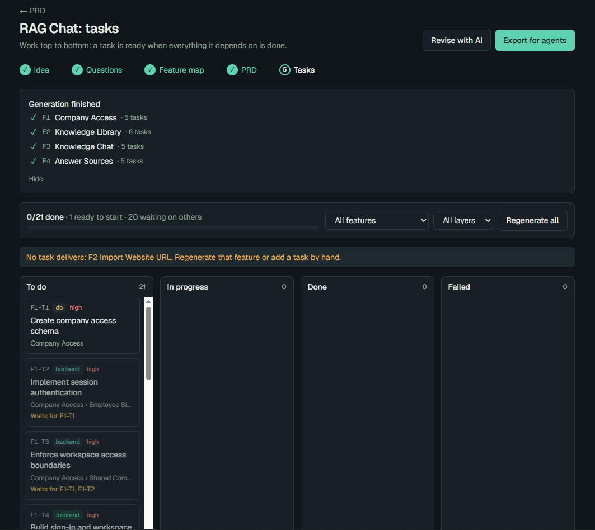

# Specwright

**Turn an app idea into a reviewed PRD, a feature map and ordered coding tasks that an AI coding agent can build from.**

You describe an app in a few sentences. Specwright asks clarifying questions, proposes the features, writes a short,
checkable product requirements document (PRD), breaks the work into small tasks with acceptance criteria, and exports
everything as Markdown files that Claude Code, Codex, Cursor or any other coding agent can work through one task at a
time.

It runs locally for one person: no login, no cloud account. API keys stay on the local server, and all data is in
one SQLite file.

## Screenshots

Sample plan: a RAG chatbot that answers employee questions from company documents.

<table>
  <tr>
    <th width="33%">Feature map</th>
    <th width="33%">PRD</th>
    <th width="33%">Tasks</th>
  </tr>
  <tr>
    <td><a href="docs/images/feature-map.png"></a></td>
    <td><a href="docs/images/prd.png"></a></td>
    <td><a href="docs/images/tasks.png"></a></td>
  </tr>
  <tr>
    <td>Agree on menus and screens before the PRD is written.</td>
    <td>Versioned, with a quality check and AI rewrite.</td>
    <td>Ordered by dependency on a 4-column board, ready to export.</td>
  </tr>
</table>

## How to use

### Setup

Requires Node.js 20+ and an API key for at least one provider (or a local Ollama).

```bash
cd specwright
npm install
cp .env.example .env.local   # add at least one API key
npm run dev                  # open http://localhost:3000
```

Open **Models** and press **Test** on the default model to check your key.

### Making a plan

1. **Idea.** Create a project, then a plan. Write the idea, choose the output language and a tech stack (presets:
   Next.js + PostgreSQL, React + Node, Laravel + MySQL, Expo + Supabase).
2. **Questions.** Answer 3–6 generated questions (text or choices, each skippable). If answers are vague, up to 3
   follow-ups are asked. Skipped answers become explicit assumptions in the PRD.
3. **Feature map.** Review the proposed features (menus/modules) and sub-features (screens/actions) with phases and
   priorities. Edit, add, remove or reorder them. This is the cheapest place to change scope.
4. **PRD.** Generate the PRD (streamed, 12 fixed sections with diagrams). Edit it freely; every change is a new
   version you can compare and restore. Run the **quality check** and use **Fix with AI** on the findings.
5. **Tasks.** Generate tasks feature by feature. Each has a layer (db / backend / frontend / test), acceptance
   criteria and dependencies. Track progress on the 4-column board.
6. **Export.** Press **Export for agents**, download the ZIP or write it into your repository, and paste the
   kick-off prompt into your agent.

At any step, **Revise with AI** opens a chat that answers questions about the plan or proposes changes as diffs you
accept or reject.

## How it works

<p align="center">
  
</p>

Each step feeds the next, and every step's output stays editable.

| # | Step | What the AI does | What you control | Output |
|:-:|---|---|---|---|
| 1 | **Idea** | – | Idea text, output language, tech stack | The plan's brief |
| 2 | **Questions** | Asks 3–6 typed questions, then up to 3 follow-ups on vague answers | Answer, pick options, or skip | Answers; skipped ones become explicit assumptions |
| 3 | **Feature map** | Proposes 3–9 features with 2–5 sub-features, phases and priorities | Edit, add, remove, reorder | The agreed scope |
| 4 | **PRD** | Writes 12 fixed sections around the map, with sequence and ER diagrams | Edit, compare and restore versions | A versioned PRD with `FR-n` / `NFR-n` IDs |
| 5 | **Tasks** | Plans tasks feature by feature, reusing earlier groundwork | Status, edits, manual tasks | Ordered tasks with layers, criteria and dependencies |
| 6 | **Export** | – | ZIP or write into your repo | `AGENTS.md`, `PRD.md`, `features/`, `tasks/`, `tasks.json` |

Two loops keep the plan honest:

- **Quality check (on the PRD).** Nine instant rules re-run on every version: missing sections, duplicate or unknown
  IDs, requirements no feature covers, drift from the feature map, fewer than 3 acceptance criteria, vague words
  like "fast" without a number, missing diagrams. An AI review adds testability, consistency and scope checks.
  **Fix with AI** rewrites only the affected section and saves a new version.
- **Revise with AI (across map, PRD and tasks).** Ask a question and get an answer that cites IDs, or ask for a
  change and get typed proposals shown as diffs. Nothing changes until you accept, and a proposal is refused if its
  target changed in the meantime.

### Design principles

- **Scope before prose.** The PRD must list exactly the features on the map, which keeps it short (about 2,400 words)
  and stops it inventing features.
- **Nothing is overwritten.** PRD versions are append-only; restoring an old one creates a new version.
- **Always a valid build order.** Dependencies can only point to earlier tasks, so the task graph cannot loop and the
  exported numbering (`001-…`, `002-…`) is a run order an agent can follow top to bottom.
- **Any model, per step.** Claude via the Anthropic SDK; OpenAI, Gemini, DeepSeek, OpenRouter, Moonshot, Groq, Ollama
  or any OpenAI-compatible endpoint via the OpenAI SDK. Structured steps are validated with Zod, and every call is
  logged in the `generation_runs` table.
- **Safe export.** Writing to a folder never touches files Specwright didn't create; a manifest lets re-exports
  clean up only their own old files.

### Under the hood

```
Browser (React 19)  ──server actions / streaming──▶  Next.js 16 server  ──▶  AI adapters
                                                        │                    ├─ Anthropic SDK  → Claude
                                                        │                    └─ OpenAI SDK     → OpenAI, Gemini, Ollama, …
                                                        ▼
                                                SQLite (Drizzle ORM)  data/app.db
```

**Stack:** Next.js 16 (App Router, server actions), React 19, TypeScript, Tailwind 4, SQLite + Drizzle ORM,
React Flow, Mermaid, Zod.

**Data:** stored in `data/app.db` (ignored by git). To back up, stop the app and copy the `data/` folder. Migrations
run automatically on startup.

> Specwright has no authentication. Run it on `localhost` only.

## Future improvements

Near term:
- **Plan export / import (.json)** for backup, moving between machines and forking a plan.
- **Protect hand edits** when the feature map or tasks are regenerated.
- **Regenerate one PRD section** with a short instruction.
- **Traceability grid**: requirements × features × tasks, with gaps highlighted.
- **Automated tests** for the quality rules, PRD parsing, task ordering, chat changes and the folder writer.

Later:
- Stack preset editor, drag and drop on the board and map, token and cost tracking per plan.
- Sync task progress back from the exported `AGENTS.md` checkboxes.
- Indonesian UI, reference attachments on the idea step, codebase-aware planning.
- A hosted multi-user version on Postgres with sign-in and share links.

## Documentation

- [User guide](docs/user-guide.md): each step in detail, with tips
- [Configuration](docs/configuration.md): providers, models, environment variables, backups
- [Export format](docs/export-format.md): the files written for coding agents
- [Architecture](docs/architecture.md): code map, data model, extending the app
- [Roadmap](docs/roadmap.md): what is built, limitations, next steps
- [Troubleshooting](docs/troubleshooting.md): common errors and fixes
