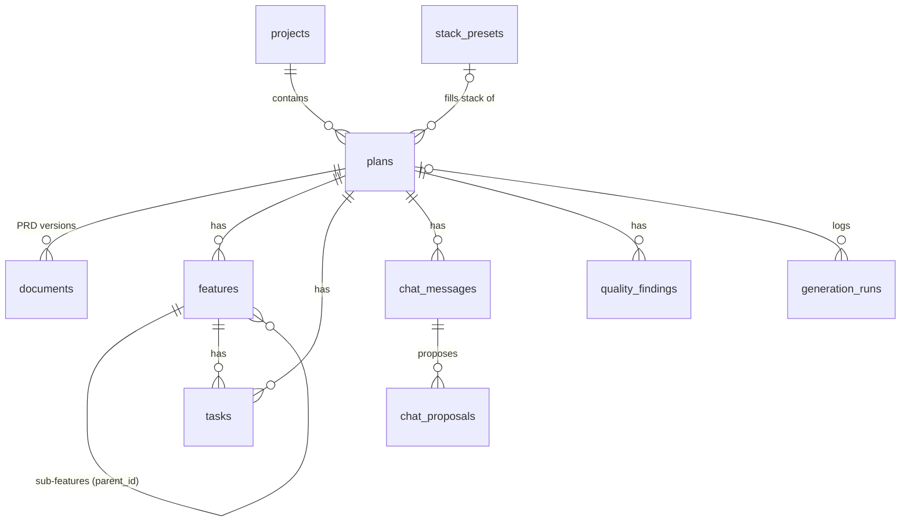

# Architecture

Specwright is a single Next.js app. Pages are React Server Components that read from SQLite directly; mutations are
server actions; the two endpoints that need streaming or binary output are route handlers. There is no separate
backend and no client-side data store.

> **Note for contributors:** this project uses Next.js 16, which has breaking changes from older versions. Read the
> guide in `node_modules/next/dist/docs/` before changing routing, caching or server actions (see `AGENTS.md`).

## Code map

| Path | What |
|---|---|
| `src/app/page.tsx` | Home: project list |
| `src/app/projects/[id]/page.tsx` | A project and its plans |
| `src/app/plans/new/page.tsx` | New plan (idea form) |
| `src/app/plans/[id]/page.tsx` | Idea and questions steps |
| `src/app/plans/[id]/features/page.tsx` | Feature map |
| `src/app/plans/[id]/prd/page.tsx` | PRD, versions, quality panel |
| `src/app/plans/[id]/tasks/page.tsx` | Task board and export |
| `src/app/settings/page.tsx` | Models page |
| `src/app/actions.ts` | Server actions for projects, plans and model settings |
| `src/app/plan-actions.ts` | Server actions for every plan step: questions, features, PRD edits, tasks, quality, chat, export |
| `src/app/api/plans/[id]/prd/route.ts` | `POST`: streams PRD generation |
| `src/app/api/plans/[id]/export/route.ts` | `GET`: export ZIP |
| `src/components/` | Client components (feature map, PRD workspace, task board, chat drawer, export dialog, …) |
| `src/db/schema.ts` | All tables |
| `src/db/index.ts` | Database connection, auto-migration and preset seeding |
| `src/lib/ai/` | Provider catalogue, Anthropic and OpenAI-compatible adapters, per-step model choice, run logging |
| `src/lib/prompts/` | One prompt module per step: `questions`, `features`, `prd`, `quality`, `tasks`, `chat` |
| `src/lib/quality-rules.ts` | Deterministic PRD checks |
| `src/lib/quality.ts` | AI review and Fix with AI |
| `src/lib/prd-parse.ts` | Splits the PRD into numbered sections and extracts IDs |
| `src/lib/documents.ts` | PRD versioning helpers |
| `src/lib/features.ts`, `src/lib/tasks.ts` | Feature tree and task logic (ordering, dependencies, codes) |
| `src/lib/chat-ops.ts` | Resolves, validates and applies chat proposals |
| `src/lib/export.ts`, `src/lib/export-folder.ts` | Export file builder and safe folder writer |
| `src/lib/plan-steps.ts` | Step order, feature icons, output languages |
| `drizzle/` | SQL migrations |

## Data model



| Table | Notes |
|---|---|
| `projects` | Name and description |
| `plans` | Idea, language, tech stack (JSON), questions and answers (JSON), current step |
| `stack_presets` | Seeded starter stacks |
| `documents` | One row per PRD version; the highest `version` is current. `reason` records what produced it. |
| `features` | Root features and sub-features in one table, linked by `parent_id`. `source = user` marks hand edits. |
| `tasks` | Belongs to a root feature, optionally a sub-feature. `depends_on` is a JSON list of task ids. |
| `chat_messages`, `chat_proposals` | Revision chat history and the typed operations it proposed, with status |
| `quality_findings` | Rule and AI findings, tied to the PRD version they were found on |
| `generation_runs` | Log of every AI call |
| `settings` | Key/value store (model choices, remembered export folders) |

The schema avoids SQLite-only features so it can move to Postgres with Drizzle later.

## AI layer

```
step code ─▶ src/lib/ai/index.ts ─▶ modelFor(step) ─▶ parseModelSpec("provider:model")
                                         │
                       ┌─────────────────┴─────────────────┐
                 anthropicAdapter                 openAiCompatibleAdapter
                 (@anthropic-ai/sdk)              (openai SDK, any base URL)
                                         │
                                  logRun → generation_runs
```

- **Steps** are declared in `STEPS` in `src/lib/ai/index.ts`. Each can have its own model.
- **Structured output:** structured steps pass a Zod schema; the adapter asks the model for JSON and the result is
  validated before it touches the database.
- **Streaming:** the PRD is streamed through the route handler, and the request is aborted if the user presses Stop.
- **Logging:** every call, successful or not, is written to `generation_runs`.

## Invariants worth keeping

These rules keep the plan consistent. Changes should preserve them.

1. **PRD versions are append-only.** Every change inserts a new `documents` row. Nothing updates an old version.
2. **The PRD follows the map.** Section 5 must list exactly the map's features; the `map-mismatch` rule enforces it.
3. **Dependencies only point backwards** (earlier task in the same feature, or a task in an earlier feature), so the
   task graph is always acyclic and the export order is valid.
4. **Chat proposals are applied safely** (`src/lib/chat-ops.ts`):
   - references are resolved to ids when the proposal is created, because codes like `F2-T3` shift;
   - a PRD section change is refused if that section changed after it was proposed;
   - accepted PRD edits from one reply become a single new version;
   - removing a task or feature never leaves dangling dependencies;
   - rule checks re-run after every apply.
5. **Folder export never touches files it did not write** (manifest-based clean-up, path-escape checks).

## Extending Specwright

### Add a provider

If it speaks the OpenAI Chat Completions API, add one entry to `PROVIDERS` in `src/lib/ai/providers.ts` with its id,
label, key variable and default base URL, then add the key to `.env.example`. Anything else needs a new adapter next
to `anthropic.ts` implementing `LlmAdapter` from `src/lib/ai/types.ts`.

### Change a prompt

Prompts live in `src/lib/prompts/<step>.ts`. Use the `generation_runs` table to compare outputs before and after a
change. If the output shape changes, update the Zod schema next to the prompt.

### Change the database

1. Edit `src/db/schema.ts`.
2. Run `npx drizzle-kit generate` to create a migration in `drizzle/`.
3. Restart the app; migrations apply automatically on startup.

Commit the generated SQL and the `drizzle/meta` snapshot together.

### Add a quality rule

Add a check to `src/lib/quality-rules.ts` that returns findings with a unique `rule` id, a severity and the section it
targets. It runs automatically on every new PRD version, and **Fix with AI** works with it if the finding names a
section.
